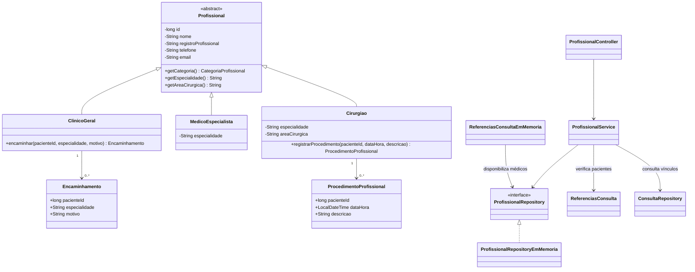

# Profissionais — Sprint 2

Implementação da parte de profissionais descrita em `SPRINT2_TPPM-2.pdf`.

## Requisitos atendidos

- Dados comuns encapsulados em `Profissional`: nome, registro profissional, telefone e e-mail.
- Herança com três categorias: `ClinicoGeral`, `MedicoEspecialista` e `Cirurgiao`.
- Especialidade obrigatória para especialistas e cirurgiões; área de atuação cirúrgica obrigatória para cirurgiões.
- Cadastro, consulta, edição, exclusão e filtros por nome, categoria e especialidade em `/profissionais`.
- Clínico geral: consulta dos atendimentos e registro de encaminhamentos para atendimento especializado.
- Especialista: busca por área de atuação e integração com a validação de especialidade já existente em consultas.
- Cirurgião: registro e consulta de procedimentos realizados, incluindo paciente, data, horário e descrição.
- Página `/profissionais.html` conectada à API, com cadastro, filtros, ordenação, edição, detalhes, exclusão e formulários específicos por categoria.

Consultas de rotina, avaliações e observações continuam sendo registradas pelo módulo de consultas existente. A ficha do profissional mostra esses registros e oferece acesso à tela de consultas. Os novos médicos são disponibilizados por `ReferenciasConsultaEmMemoria`, preservando a interface utilizada pelas consultas.

O registro de procedimentos aqui é o histórico de atuação do cirurgião exigido na seção de profissionais. A modalidade de atendimento cirúrgico, com agendamento e estados próprios, pertence ao escopo de atendimentos.

## API

| Método | Caminho | Operação |
| --- | --- | --- |
| GET | `/profissionais?nome=Ana&categoria=ESPECIALISTA&especialidade=Cardiologia` | Listar e filtrar; parâmetros opcionais |
| POST | `/profissionais` | Cadastrar, com resposta 201 e `Location` |
| GET | `/profissionais/{id}` | Obter detalhes |
| PUT | `/profissionais/{id}` | Atualizar cadastro completo |
| DELETE | `/profissionais/{id}` | Excluir cadastro sem vínculos |
| GET | `/profissionais/{id}/consultas` | Consultas, motivos, observações e situação |
| GET / POST | `/profissionais/{id}/encaminhamentos` | Consultar / registrar encaminhamentos do clínico |
| GET / POST | `/profissionais/{id}/procedimentos` | Consultar / registrar procedimentos do cirurgião |

Exemplo de cadastro de cirurgião:

```json
{
  "nome": "Ana Silva",
  "registroProfissional": "CRM/MG 12345",
  "telefone": "31999999999",
  "email": "ana@hospital.com",
  "categoria": "CIRURGIAO",
  "especialidade": "Ortopedia",
  "areaCirurgica": "Cirurgia do joelho"
}
```

Para clínico geral, use `CLINICO_GERAL` sem especialidade nem área cirúrgica. Para especialista, use `ESPECIALISTA` com especialidade, sem área cirúrgica.

Encaminhamento:

```json
{"pacienteId": 10, "especialidade": "Ortopedia", "motivo": "Avaliação do joelho"}
```

Procedimento realizado:

```json
{"pacienteId": 10, "dataHora": "2026-10-20T10:30:00", "descricao": "Artroscopia do joelho"}
```

## Regras e armazenamento

Campos obrigatórios não aceitam texto em branco; e-mail deve ter formato válido. Registro profissional é único, sem distinguir maiúsculas de minúsculas e ignorando espaços nas extremidades. IDs devem ser positivos. Encaminhamentos e procedimentos exigem paciente previamente registrado na referência de pacientes existente. Datas de procedimentos realizados não podem ser futuras.

Profissionais com consultas, procedimentos ou encaminhamentos não podem ser excluídos. Categoria e especialidade ficam protegidas após a existência de vínculos; nome e contato continuam editáveis. Validações malsucedidas não alteram o cadastro anterior.

Como nos outros módulos, os dados ficam em memória e são perdidos ao reiniciar a aplicação. Não há cadastro de pacientes neste módulo; a integração usa `ReferenciasConsulta.pacienteExiste`, já disponível no projeto.

Erros retornam JSON com `mensagem`: 400 para dados inválidos, 404 para registro inexistente e 409 para conflito de negócio.

## Diagrama de classes da parte de profissionais



## Verificação

`ProfissionalServiceTest` cobre categorias, validações, unicidade, filtros, encaminhamentos, procedimentos, vínculos e integração com consultas. `ProfissionalApiTest` cobre os contratos HTTP, erros, atualização sem perda de dados e entrega da tela e do JavaScript.

Execute `mvn test` e abra `http://localhost:8080/profissionais.html` após iniciar a aplicação com `mvn spring-boot:run`.
